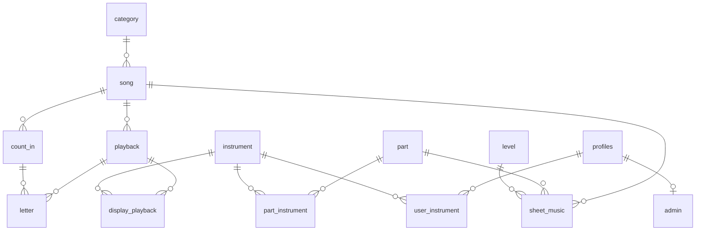

# zamaric-database

Datenbank-Repo von Zamaric: das Schema von Supabase als SQL-Migrationen und das alte Python-Backend (Legacy), das früher die Inhalte an die App ausgeliefert hat.

Verwandte Repos:

- `zamaric`: Flutter-App für Bläserensembles, liest aus Supabase
- `zamaric-toolchain`: Upload-Tool und Entwicklerseite auf dem Pi, mit gemeinsamem Python-Code

---

## Inhalt

1. [TODO](#todo)
2. [Aufbau](#aufbau)
3. [Supabase](#supabase)
4. [Altes Backend (Legacy)](#altes-backend-legacy)

---

## TODO

### Backend

- Accounts und Analytics in Supabase umsetzen
- Skript für DB Backup machen (evtl. für Song DB oder auch User)

### Tests

- Backend mit pytest: parse_atrributes in noten_watcher.py/playback_watcher.py + Buchstaben-TXT-Parsing (rote Tests beweisen erst die Audit-Bugs B1-B3, dann fixen bis grün)
- Entwicklerseite, SQL (gegen lokales Postgres/PGlite mit allen Migrationen): `integrity_report()` je `check_name` ein Fall, der anschlägt, und einer, der nicht anschlägt (u. a. Buchstabe genau am Ende ist ok, wartender Song ohne Playback meldet nichts); `send_ntfy` schreibt eine Zeile in `notification`

---

## Aufbau

| Teil | Ordner | Stand |
|---|---|---|
| Supabase | `supabase/` | Neues Backend: Datenbank, Dateien, Accounts |
| Altes Backend | `legacy/` | FastAPI, Watcher und SQLite auf dem Pi. Abgeschaltet, die App nutzt es nicht mehr |

```
supabase/migrations/      Schema von Supabase als SQL
legacy/                   altes Backend
venv/                     Python-Umgebung (nicht im Repo)
```

---

## Supabase

### Projekt

- Free-Plan, Region Frankfurt.
- **Buckets**, beide privat:
  - `audio` (`audio/mpeg`): Playbacks und Einzähler
  - `sheet_music` (`application/pdf`): Noten
  - Dateien heißen `<uuid>.mp3` bzw. `<uuid>.pdf`. Im Free-Plan ist eine Datei höchstens 50 MB groß.
- **Vault-Secret `ntfy_topic`:** Topic für die Benachrichtigung bei neuen und geänderten Songs. Fehlt es, schlägt jedes Anlegen und Ändern eines Songs fehl (außer wenn sich nur Verlag oder Link ändern).
- **Extensions:** `moddatetime` (pflegt `updated_at`), `pg_cron` (wartende Änderungen übernehmen), `pg_net` (ntfy).
- **Admin:** Der Account des Geschäftspartners steht in `admin`. Phil arbeitet direkt im Dashboard. Die Entwicklerseite meldet sich mit einem Admin-Account an (`ADMIN_EMAIL` in ihrer `.env`). Ihr Board liegt nicht in Supabase, sondern auf dem Pi (siehe README von `zamaric-toolchain` → „Entwicklerseite“).

### Migrationen

Das Schema steht als SQL in `supabase/migrations/`. Jede Migration wird einmal im SQL-Editor des Dashboards ausgeführt, in der Reihenfolge der Dateinamen.

| Migration | Inhalt |
|---|---|
| `20261009000000_initial_schema` | Grundschema, `profiles` mit Trigger für neue Accounts, Leserechte |
| `20261009190000_add_admin` | Tabelle `admin`, `private.is_admin()`, Schreibrechte für Admins |
| `20261009223000_count_in_song_and_category_position` | Einzähler gehören zu einem Song, `category.position` |
| `20261016220000_song_approval` | Freigabe: `created_at`, `approved_at`, Cron-Job, ntfy, Admins dürfen nur noch hinzufügen |
| `20261017120000_song_unique_name_per_category` | Songname einmalig pro Kategorie |
| `20261018120000_letter_unique_position` | Buchstaben einmalig pro Stelle statt pro Name |
| `20261018130000_playback_type_normal` | `playback.type` nie leer, Standard `Normal`, einmalig pro Song |
| `20261018140000_song_release_at` | Geplanter Freigabetag `release_at` |
| `20261018150000_unique_case_insensitive` | Alle Namen einmalig ohne Rücksicht auf Groß-/Kleinschreibung |
| `20261020120000_part` | Stimmen (`part`) statt Instrumenten an den Noten, View `instrument_part` |
| `20261026120000_import_song` | `import_song()` für das Upload-Tool, Regeln für Namen und Längen an den Tabellen |
| `20261028120000_app_read_files` | Angemeldete lesen Dateien freigegebener Songs aus den Buckets, `private.file_is_approved()` |
| `20261101120000_song_publisher` | Verlag und Link zu den Verlagsnoten (`publisher_name`, `publisher_url`), `import_song()` übernimmt beide |
| `20261101130000_song_update` | Songs ändern: `release_at` als einziger Freigabe-Zeitpunkt (`approved_at` und der Cron-Job `approve_pending_songs` entfallen), wartende Änderungen als Zeilen (`replaces_id`, `release_at`), Prüfsummen (`sha256`), `update_song()`, `set_file_sha256()`, `unused_files()`, Cron-Job `apply_song_changes` |
| `20261102120000_content_version` | `content_version()`: md5-Fingerabdruck über alle Zeilen, die der Account sehen darf (`security invoker`, die Lese-Policies gelten). Die App lädt die Tabellen nur, wenn er sich ändert |
| `20261106120000_dev_site` | Entwicklerseite: `notification` mit `send_ntfy()` als einziger Quelle, `notification_feed()`, Prüf- und Übersichtsfunktionen (`integrity_report()`, `missing_files()`, `storage_usage()`, `largest_files()`, `pending_releases()`, `cron_runs()`) |
| `20261106180000_integrity_tuning` | `integrity_report()`: „Song ohne Noten“ entfällt, doppelte Noten nur noch bei mehreren doppelten Dateien in einem Song oder derselben Datei in verschiedenen Songs |

### Datenmodell



Alle IDs außer bei Accounts sind `bigint` (Identity). Jede Tabelle mit `updated_at` aktualisiert die Spalte bei jeder Änderung selbst (`moddatetime`). „Einmalig“ heißt immer: ohne Rücksicht auf Groß-/Kleinschreibung (`unique`-Index auf `lower(...)`).

#### Inhalte

**`category`**: Kategorie, z. B. „Grande Fanfare“

| Spalte | Typ | Regeln |
|---|---|---|
| `id` | bigint | |
| `name` | text | einmalig |
| `position` | integer | Reihenfolge in der App, nicht einmalig |
| `updated_at` | timestamptz | |

**`song`**

| Spalte | Typ | Regeln |
|---|---|---|
| `id` | bigint | |
| `name` | text | saubere Schreibweise (siehe unten), einmalig pro Kategorie |
| `category_id` | → `category` | |
| `created_at` | timestamptz | Upload-Zeitpunkt, setzt der Trigger beim Anlegen auf jetzt. Nur zur Info |
| `release_at` | timestamptz | ab wann der Song in der App sichtbar ist. Beim Anlegen rechnet der Trigger ihn aus dem mitgeschickten Wunschtag (oder `null`) aus, siehe [Freigabe](#freigabe-und-benachrichtigung) |
| `publisher_name` | text | Verlag der Noten, `null` = keine Angabe. Saubere Schreibweise |
| `publisher_url` | text | Link zu den Verlagsnoten, `null` = keine Angabe. Höchstens 2000 Zeichen, passt auf `^https://([A-Za-z0-9]([A-Za-z0-9-]*[A-Za-z0-9])?\.)+[A-Za-z][A-Za-z0-9-]*[A-Za-z0-9]([/?#][!-~]*)?$`: nur https, eine Domain (keine IP, kein Port, kein `name@` davor), danach nur sichtbare ASCII-Zeichen |
| `updated_at` | timestamptz | |

**`playback`**

| Spalte | Typ | Regeln |
|---|---|---|
| `id` | bigint | |
| `song_id` | → `song` | |
| `type` | text | Anzeigename der Variante, Standard `Normal`, saubere Schreibweise, einmalig pro Song |
| `duration_ms` | integer | > 0 |
| `path` | text | Dateiname im Bucket `audio`, einmalig. `null` nur bei einer wartenden Änderung, die die MP3 behält |
| `instrument_mode` | text | `all`, `only` oder `except` (siehe `display_playback`) |
| `sha256`, `replaces_id`, `release_at` | | siehe [Änderungen](#änderungen) |
| `updated_at` | timestamptz | |

**`count_in`**: Einzähler. Mehrere Playbacks eines Songs können denselben benutzen.

| Spalte | Typ | Regeln |
|---|---|---|
| `id` | bigint | |
| `song_id` | → `song` | wird mit dem Song gelöscht |
| `name` | text | z. B. `4-4`, saubere Schreibweise, einmalig pro Song |
| `path` | text | Dateiname im Bucket `audio`, einmalig |
| `duration_ms` | integer | > 0 |
| `sha256`, `replaces_id`, `release_at` | | siehe [Änderungen](#änderungen) |
| `updated_at` | timestamptz | |

**`letter`**: Probenbuchstabe eines Playbacks

| Spalte | Typ | Regeln |
|---|---|---|
| `id` | bigint | |
| `playback_id` | → `playback` | wird mit dem Playback gelöscht |
| `name` | text | `A`–`Z`, Zahl, `D.S.`, `D.C.` oder `Coda`. Darf sich wiederholen (nach `D.S.`/`D.C.`) |
| `position_ms` | integer | ≥ 0, einmalig pro Playback |
| `count_in_id` | → `count_in` | |
| `updated_at` | timestamptz | |

**`display_playback`**: wem ein Playback angezeigt wird. Bei `instrument_mode` = `all` sehen es alle und es gibt keine Zeilen. Bei `only` sehen es nur die eingetragenen Instrumente, bei `except` alle außer ihnen.

| Spalte | Typ | Regeln |
|---|---|---|
| `playback_id` | → `playback` | wird mit dem Playback gelöscht |
| `instrument_id` | → `instrument` | |

Schlüssel: (`instrument_id`, `playback_id`).

**`sheet_music`**: Noten

| Spalte | Typ | Regeln |
|---|---|---|
| `id` | bigint | |
| `song_id` | → `song` | |
| `part_id` | → `part` | |
| `level_id` | → `level` | |
| `path` | text | Dateiname im Bucket `sheet_music`, einmalig |
| `sha256`, `replaces_id`, `release_at` | | siehe [Änderungen](#änderungen) |
| `updated_at` | timestamptz | |

Einmalig: (`song_id`, `part_id`, `level_id`).

#### Änderungen

Eine Änderung an einem bestehenden Song steht als normale Zeile in `count_in`, `playback` oder `sheet_music`. Diese drei Tabellen haben dafür:

| Spalte | Typ | Regeln |
|---|---|---|
| `sha256` | text | Prüfsumme der Datei (64 Hex-Zeichen). Bei Dateien von vor `song_update` leer, bis Container 2 sie nachträgt |
| `replaces_id` | → dieselbe Tabelle | die Zeile, die diese wartende Zeile ersetzt. `null` = ganz neue Datei. Höchstens eine wartende Zeile pro Zeile, wird mit ihr gelöscht |
| `release_at` | timestamptz | `null` = normale Zeile. Gesetzt = wartende Änderung, sichtbar ab diesem Zeitpunkt |

- Die App sieht nur Zeilen mit `release_at is null`. Die Einmaligkeits-Regeln (Zusatz, Einzählername, Stimme + Level) gelten getrennt für sichtbare und für wartende Zeilen.
- Pro Song wartet höchstens eine Änderung. Ein neuer Upload löscht die wartende samt ihren Buchstaben und Sichtbarkeiten.
- **Übernehmen** (`private.apply_song_changes(song_id)`): Eine Zeile mit `replaces_id` wird in die alte Zeile kopiert (Datei, Prüfsumme, Länge, Schreibweise, Buchstaben, Sichtbarkeit), dann gelöscht. So bleibt die ID gleich, und Notizen, Downloads und „Zuletzt gespielt“ in der App bleiben erhalten. Eine Zeile ohne `replaces_id` bekommt `release_at = null` und ist damit sichtbar.
- Der Cron-Job `apply_song_changes` läuft stündlich und übernimmt jede Änderung, deren `release_at` erreicht ist (`private.apply_due_song_changes()`). Ein Fehler bei einem Song hält die anderen nicht auf und steht als Warnung im Postgres-Log.

#### Instrumente und Stimmen

**`instrument`**: Instrument, das man in der App wählen kann

| Spalte | Typ | Regeln |
|---|---|---|
| `id` | bigint | |
| `name` | text | z. B. `Trompete` |
| `transposition` | text | z. B. `B`, leer, wenn es keine gibt (`DrumSet`) |
| `updated_at` | timestamptz | |

Einmalig: (`name`, `transposition`). Ein neues Instrument legt per Trigger die gleichnamige Stimme an und ordnet sie ihm zu.

**`part`**: Stimme, für die es Noten gibt, z. B. `Trompete in B` oder `DrumSet Hi-Hat`

| Spalte | Typ | Regeln |
|---|---|---|
| `id` | bigint | |
| `name` | text | |
| `transposition` | text | |
| `for_whole_transposition` | boolean | `true`: Alle Instrumente dieser Stimmung sehen die Stimme, z. B. `in B Stimmung` |
| `updated_at` | timestamptz | |

Einmalig: (`name`, `transposition`).

**`part_instrument`**: feste Zuordnung, welches Instrument welche Stimme sieht. Schlüssel: (`part_id`, `instrument_id`), beide werden mitgelöscht.

**View `instrument_part`**: alle Zuordnungen zusammen, also `part_instrument` plus jede Stimme mit `for_whole_transposition` für alle Instrumente derselben Stimmung. Das Upload-Tool zeigt damit, wer welche Noten sieht.

**`level`**: Schwierigkeitsgrad, z. B. `Normal`, `Anfänger`, `Leicht`

| Spalte | Typ | Regeln |
|---|---|---|
| `id` | bigint | |
| `name` | text | einmalig. `Normal` muss es geben |
| `updated_at` | timestamptz | |

#### Accounts

**`profiles`**: ein Eintrag pro Account, legt der Trigger `handle_new_user` bei der Registrierung an

| Spalte | Typ | Regeln |
|---|---|---|
| `id` | uuid | → `auth.users`, wird mit dem Account gelöscht |
| `updated_at` | timestamptz | |

**`user_instrument`**: welche Instrumente ein Nutzer spielt. Schlüssel: (`user_id` → `profiles`, `instrument_id` → `instrument`).

**`admin`**: Accounts, die Songs hochladen dürfen. Nur `id` → `profiles`.

#### Entwicklerseite

Gehört nicht zu den Inhalten der App, `content_version()` und der Sync lesen sie nicht. Das Board der Entwicklerseite liegt nicht hier, sondern in einer SQLite-Datei auf dem Pi (siehe README von `zamaric-toolchain` → „Entwicklerseite“ → „Board (SQLite)“).

**`notification`**: jede Nachricht an ntfy, geschrieben nur von `private.send_ntfy()`

| Spalte | Typ | Regeln |
|---|---|---|
| `id` | bigint | |
| `title`, `message` | text | wie an ntfy geschickt |
| `request_id` | bigint | ID von `net.http_post`, zeigt für ein paar Stunden auf `net._http_response` |
| `sent_at` | timestamptz | |

#### Saubere Schreibweise

`private.is_clean_name()` prüft `song.name`, `song.publisher_name`, `playback.type` und `count_in.name`: nicht leer, höchstens 100 Zeichen, kein Leerzeichen am Anfang oder Ende, keine Steuer- oder Formatzeichen (Unicode `Cc`/`Cf`). Die Regel hängt an den Tabellen und gilt deshalb auch für Einträge im SQL-Editor.

### Rechte (RLS)

RLS ist auf jeder Tabelle an. Ohne Anmeldung (`anon`) sieht man nichts.

| Was | Angemeldete | Admins |
|---|---|---|
| `category`, `level`, `instrument`, `part`, `part_instrument` | lesen | lesen |
| `song` und alles, was dazugehört | nur freigegebene lesen, ohne wartende Änderungen | alles lesen, nur zu wartenden Songs hinzufügen, Änderungen nur über `update_song()` |
| `profiles` | eigenes lesen und ändern | wie Angemeldete |
| `user_instrument` | eigene lesen, hinzufügen, entfernen | wie Angemeldete |
| `admin` | nichts | nichts |
| `notification` | nichts | lesen |
| Buckets `audio`, `sheet_music` | nur Dateien sichtbarer Zeilen freigegebener Songs lesen | lesen, hinzufügen, unbenutzte Dateien löschen |

- Ändern oder Löschen von Inhalten darf niemand direkt über die API. Admins ändern Songs nur über `update_song()`, die selbst prüft, was erlaubt ist. Alles andere macht Phil im Dashboard oder SQL-Editor, Dateien im Bucket separat über Storage.
- **Unbenutzte Dateien** (`private.file_is_unused()`): keine Zeile zeigt auf sie (auch keine wartende), der Name hat die Form `<uuid>.mp3` / `<uuid>.pdf`, und sie ist älter als eine Stunde. Nur solche Dateien dürfen Admins löschen. So erwischt das Aufräumen nie eine Datei, die gerade erst hochgeladen wird.
- Kategorien, Level, Instrumente und Stimmen pflegt nur Phil.
- Hilfsfunktionen liegen im Schema `private` und sind nicht über die API aufrufbar: `is_admin()`, `is_clean_name()`, `song_is_pending()`, `song_is_approved()`, `playback_is_pending()`, `playback_is_approved()`, `file_is_approved()`, `file_is_unused()`, `release_time()`, `send_ntfy()`, `apply_song_changes()`, `apply_due_song_changes()`, `file_rows()` (alle Datei-Zeilen mit Bucket, für die Prüfungen der Entwicklerseite).

### Freigabe und Benachrichtigung

1. Beim Anlegen setzt der Trigger `song_prepare_new` `created_at` auf jetzt und rechnet `release_at` mit `private.release_time()` aus: der erste Zeitpunkt um 4 Uhr (Europe/Berlin), der mindestens 24 Stunden nach dem Upload und nicht vor dem Wunschtag liegt.
2. Ab `release_at` ist der Song in der App sichtbar. Dafür läuft kein Job, die Leserechte vergleichen nur mit der aktuellen Zeit.
3. Der Trigger `song_notify_new` schickt über `pg_net` eine Nachricht an ntfy.sh: Song, Kategorie, Upload-Zeitpunkt und Freigabe. `pg_net` sendet erst nach dem Commit, scheitert das Anlegen, geht also nichts raus. `private.send_ntfy()` schreibt jede Nachricht zusätzlich mit der `request_id` von `pg_net` in `notification` (scheitert das Anlegen, verschwindet auch diese Zeile). Das Topic steht nur im Vault, ntfy.sh selbst hebt Nachrichten nur 12 Stunden auf.
4. Änderungen an einem freigegebenen Song warten genauso (gleiche Regel, eigenes `release_at` an den Zeilen) und übernimmt der Cron-Job `apply_song_changes`. Wartet der Song selbst noch, gelten Änderungen sofort. Verlag und Link gelten immer sofort.

**Früher freigeben** (im SQL-Editor):

```sql
-- neuer Song
update song set release_at = now() where id = …;
-- wartende Änderung an einem Song
select private.apply_song_changes(…);  -- Song-ID
```

### `import_song`

`public.import_song(payload jsonb) returns bigint` legt einen ganzen Song in einer Transaktion an. Das Upload-Tool ruft sie auf, das Manifest steht in der README von `zamaric-toolchain` unter „POST /api/upload“.

- `security invoker`: Es gelten die RLS-Regeln des Aufrufers. Ausführen darf sie nur `authenticated`.
- `payload` ist das Manifest, `path` jeweils der Dateiname im Bucket. Der Bucket ergibt sich aus der Tabelle: `playback` und `count_in` → `audio`, `sheet_music` → `sheet_music`.
- Legt Song, Einzähler, Playbacks, Buchstaben, Playback-Instrumente und Noten an und gibt die ID des Songs zurück. Bei einem Fehler wird nichts eingetragen.
- Löst `letters[].count_in` über den Namen innerhalb desselben Songs auf. Ein Buchstabe kann also nie auf den Einzähler eines anderen Songs zeigen.
- Fehler als Meldung, die genaue Ursache steht im Detail (nur fürs Log, nie für den Browser):
  - `song_exists`: Den Song gibt es in der Kategorie schon.
  - `invalid_manifest`: falsche Form, weder Playbacks noch Noten, Buchstaben nicht streng aufsteigend oder hinter der Länge, Einzähler fehlt, `instrument_ids` passen nicht zu `instrument_mode` oder sind doppelt, oder eine Regel der Tabellen ist verletzt.
  - `forbidden`: RLS lässt das Einfügen nicht zu.
- Speichert die Prüfsumme jeder Datei (`sha256`), die Container 2 selbst rechnet.

> **Nicht im SQL-Editor ausprobieren.** Dort läuft sie als `postgres`: Sie legt einen echten Song an und löst die ntfy-Nachricht aus.

### `update_song`

`public.update_song(payload jsonb) returns timestamptz` legt eine Änderung an einem bestehenden Song an und gibt zurück, ab wann sie sichtbar ist. Das Manifest steht in der README von `zamaric-toolchain` unter „POST /api/update“.

- `security definer`: läuft als Besitzer, weil Admins über RLS keine Zeilen zu freigegebenen Songs hinzufügen dürfen. Prüft deshalb selbst, dass ein Admin aufruft (sonst `forbidden`).
- Setzt Verlag und Link sofort, löscht eine schon wartende Änderung und legt die neuen und geänderten Einträge als wartende Zeilen an. Zugeordnet wird wie bei den Einmaligkeits-Regeln: Noten über Stimme + Level, Playbacks über den Zusatz, Einzähler über den Namen. Gibt es eine sichtbare Zeile dazu, zeigt `replaces_id` auf sie.
- Ein Playback ohne `path` behält seine MP3 (nur Buchstaben, Sichtbarkeit oder Schreibweise ändern sich). Länge und Prüfsumme kommen dann aus der alten Zeile.
- Buchstaben verweisen erst auf einen Einzähler aus dieser Änderung, sonst auf einen sichtbaren.
- Wartet der Song noch auf seine erste Freigabe, übernimmt sie die Änderung sofort und gibt die Freigabe des Songs zurück.
- Schickt eine ntfy-Nachricht pro Aufruf mit der Zahl der neuen oder geänderten Noten, Playbacks und Einzähler, außer es haben sich nur Verlag oder Link geändert.
- Fehler: `forbidden`, `invalid_manifest` (falsche Form, Song fehlt, Playback ohne `path` ohne Vorlage, Buchstaben nicht streng aufsteigend oder hinter der Länge, Einzähler fehlt, `instrument_ids` passen nicht zu `instrument_mode` oder sind doppelt, Regel der Tabellen verletzt).

**`set_file_sha256(kind, row_id, hash)`**: trägt die Prüfsumme einer alten Datei nach (`kind` = `count_in`, `playback` oder `sheet_music`). Nur für Admins, überschreibt nie eine vorhandene.

**`unused_files()`**: Liste (`bucket`, `name`) der Dateien, die Admins löschen dürfen (siehe [Rechte](#rechte-rls)). Für Nicht-Admins leer.

### Funktionen der Entwicklerseite

Aus `20261106120000_dev_site` (`integrity_report()` in der Fassung aus `20261106180000_integrity_tuning`), aufgerufen von Container 2 der Entwicklerseite (siehe README von `zamaric-toolchain` → „Entwicklerseite“). Ausführen darf sie nur `authenticated`, jede prüft zuerst `private.is_admin()` und wirft sonst `forbidden`. Sie lesen nur, laufen als Besitzer (`security definer`, `search_path ''`) und lesen `storage.objects` höchstens. Gelöscht wird im Bucket nie per SQL, nur über die Storage-API.

| Funktion | Gibt zurück |
|---|---|
| `notification_feed(max_rows = 200)` | Nachrichten, neueste zuerst, mit `status_code` aus `net._http_response` (null, solange keine Antwort da ist oder nach 6 Stunden). Höchstens 1000 |
| `integrity_report()` | Funde (`check_name`, `severity`, `table_name`, `row_id`, `song_id`, `song_name`, `detail`), Liste im README von `zamaric-toolchain` → „Bereiche der Website“ |
| `missing_files()` | Zeilen, deren Datei im Bucket fehlt. Wartende Playbacks ohne eigene MP3 zählen nicht |
| `storage_usage()` | je Bucket Zahl und Größe der Dateien (`metadata.size`) |
| `largest_files(max_rows = 20)` | größte Dateien mit Tabelle und Song der Zeile, die auf sie zeigt (null = unbenutzt). Höchstens 200 |
| `pending_releases()` | wartende neue Songs und Songs mit wartenden Änderungen, mit Zahl der Einzähler, Playbacks und Noten (bei neuen Songs alle, sonst nur die wartenden) |
| `cron_runs(max_rows = 50)` | letzte Läufe aller Cron-Jobs aus `cron.job_run_details`. Höchstens 500 |

---

## Altes Backend (Legacy)

Python/FastAPI-Server in `legacy/`, der die Dateien aus einer Ordnerstruktur einliest und an die App ausliefert. Er lief auf dem Raspberry Pi direkt aus dem Repo, bis die App auf Supabase umgezogen ist. Inzwischen ist er abgeschaltet.

### Starten

Das Backend läuft in der virtuellen Umgebung `venv/`. Benötigte Pakete:

```bash
pip install fastapi uvicorn sqlalchemy schedule mutagen
```

Watcher starten (Noten- und Playback-Watcher gemeinsam):

```bash
cd legacy
python main.py
```

API starten:

```bash
cd legacy
uvicorn api:app --host 0.0.0.0 --port 8000
```

Die Watcher scannen täglich um 03:00 Uhr. Die Uhrzeit steht in `noten_watcher.py` und `playback_watcher.py`, `main.py` nimmt die aus `noten_watcher.py` für beide:

```python
aktualisierungszeit = "03:00"
```

### Ablauf

1. `main.py` startet beide Watcher.
2. Die Watcher scannen täglich um 03:00 Uhr den Ordner `stuecke/`.
3. Neue oder geänderte Dateien werden in `database.db` eingetragen, Einträge zu gelöschten Dateien werden entfernt.
4. Die API (FastAPI, `FileResponse`) liefert Metadaten und die PDF/MP3-Dateien. Die Datenbank ist SQLite über SQLAlchemy.

### Server-Betrieb (Raspberry Pi)

Auf dem Raspberry Pi laufen API und Watcher als systemd-Services. So starten sie beim Booten automatisch und nach einem Absturz neu.

> **Achtung:** Die Units unten gehen davon aus, dass dieses Repo auf dem Pi unter `/home/phil_ps/zamaric-database` liegt. `WorkingDirectory` muss auf dessen Ordner `legacy` zeigen.

#### `zamaric-api.service` — FastAPI

```ini
[Unit]
Description=Zamaric FastAPI
After=network-online.target

[Service]
Type=simple
User=phil_ps
WorkingDirectory=/home/phil_ps/zamaric-database/legacy
ExecStart=/usr/bin/uvicorn api:app --host 0.0.0.0 --port 8000
Restart=on-failure

[Install]
WantedBy=multi-user.target
```

#### `zamaric-main.service` — Watcher

```ini
[Unit]
Description=Zamaric Watcher
After=network-online.target

[Service]
Type=simple
User=phil_ps
WorkingDirectory=/home/phil_ps/zamaric-database/legacy
ExecStart=/usr/bin/python main.py
Restart=on-failure

[Install]
WantedBy=multi-user.target
```

#### Verwaltung

```bash
sudo systemctl enable zamaric-api.service     # Beim Boot starten
sudo systemctl start zamaric-api.service      # Jetzt starten
sudo systemctl status zamaric-api.service     # Status prüfen
sudo systemctl restart zamaric-api.service    # Neu starten
sudo journalctl -u zamaric-api.service -f     # Logs live verfolgen
```

### Ordnerstruktur und Dateinamen

Das alte Backend liest eine eigene, nach Art getrennte Struktur. Für das Upload-Tool gilt stattdessen ein Ordner pro Song (siehe README von `zamaric-toolchain` → „Ordnerstruktur und Namenskonvention“).

```
legacy/
├── stuecke/
│   ├── 1 Kategoriename/
│   │   ├── Noten/
│   │   │   └── Songname/
│   │   │       └── Song Name - Instrument in Transposition Level.pdf
│   │   └── Playbacks/
│   │       └── Songname/
│   │           ├── Song Name - Typ.mp3
│   │           ├── Song Name - Typ.txt  (optional)
│   │           └── Einzaehler/
│   │               └── Song Name Keyword.mp3
│   └── 2 Kategoriename/
│       └── ...
├── main.py
├── api.py
├── database.py
├── noten_watcher.py
├── playback_watcher.py
└── database.db
```

> **Wichtig:** Der Ordner `stuecke/` muss im **selben Verzeichnis** liegen wie die Watcher-Skripte.

Die Kategorie ist die Zahl am Anfang des Ordnernamens (`2 Absolute Beginners Brass` wird zu `2`). In der Datenbank steht nur diese Nummer, nicht der Name.

#### Grundregeln

- ` - ` trennt den Songnamen vom Rest.
- **Songname:** Wörter mit Leerzeichen getrennt.
- **Instrument:** **immer ein Wort**, mehrteilige Namen werden zusammengeschrieben (`DrumSet`, `EBass`).
- ` in ` trennt Instrument und Transposition, nur wenn es eine Transposition gibt.
- Umlaute sind erlaubt, sie werden intern umgewandelt.

#### Noten (PDF)

```
Song Name - Instrument in Transposition Level.pdf
Song Name - Instrument Level.pdf
Song Name - Instrument.pdf
```

| Teil | Bedeutung | Pflicht |
|---|---|---|
| `Song Name` | Name des Songs, z. B. `Chat de Gouttiere` | ja |
| `Instrument` | Instrumentenname in einem Wort, z. B. `Trompete`, `Altsaxophon` | ja |
| `Transposition` | `B`, `Es` oder `C` | nein |
| `Level` | Schwierigkeitsgrad; weglassen, wenn es nur eine Stimme gibt | nein |

Beispiele:

```
Chat de Gouttiere - Trompete in B leicht.pdf
Chat de Gouttiere - Posaune.pdf
Chat de Gouttiere - Altsaxophon in Es.pdf
```

Übliche Transpositionen:

| Transposition | Instrumente |
|---|---|
| `B` | Trompete, Klarinette, Bassklarinette, Tenorsaxophon, Sopransaxophon, Tenorhorn |
| `Es` | Altsaxophon, Baritonsaxophon |
| `C` | Flöte, Fagott, Oboe, Posaune, Euphonium, Tuba, DrumSet, E-Bass, Akkordeon, Akkordblatt, Klavier, Horn |

#### Playbacks (MP3)

```
Song Name - Typ.mp3
Song Name.mp3
```

`Typ` beschreibt die Variante, z. B. `langsamer`, `ohne Drums` oder `Solo`. Die Normal-Variante hat keinen Typ.

```
Chat de Gouttiere.mp3
Chat de Gouttiere - langsamer.mp3
Chat de Gouttiere - ohne Drums.mp3
```

#### Probenbuchstaben (TXT)

Gleicher Name wie die zugehörige MP3-Datei, nur mit `.txt`-Endung. Pro Zeile ein Buchstabe mit Startzeit und Einzähler-Keyword:

```
A 00:00:00 4-4
B 00:29:04 4-4
E 01:27:14 3-4
Coda 03:10:03 4-4
```

| Teil | Bedeutung |
|---|---|
| Buchstabe | Probenbuchstabe (A–Z), `Coda`, `D.S.` oder `D.C.` |
| Timestamp | Startzeit im Format `MM:SS:FF` (Minuten:Sekunden:Frames, 30 Frames pro Sekunde) |
| Keyword | Verweist auf den Einzähler, z. B. `4-4` oder `3-4langsamer` |

#### Einzähler (MP3)

Einzähler liegen im Unterordner `Einzaehler/` des Song-Ordners. Der Songname wird beim Einlesen abgezogen, als Kennung bleibt nur das Keyword:

```
Einzaehler/
├── Chat de Gouttiere 4-4.mp3
├── Chat de Gouttiere 3-4.mp3
├── Chat de Gouttiere 4-4langsamer.mp3
└── Chat de Gouttiere 3-4langsamer.mp3
```

In der Datenbank stehen Einzähler als normale Playback-Einträge mit `typ = "Einzaehler {Keyword}"`, z. B. `Einzaehler 4-4langsamer`.

### API-Endpunkte

```
GET /noten                   -> Alle Noten-Metadaten
GET /noten/{id}/pdf          -> Eine PDF ausliefern
GET /playbacks               -> Alle Playback-Metadaten
GET /playbacks/{id}/audio    -> Ein Playback ausliefern
```

**GET /noten**

```json
[
  {
    "id": 1,
    "kategorie": "2",
    "song": "Chat de Gouttiere",
    "instrument": "Trompete",
    "transposition": "B",
    "level": "leicht",
    "version": "2024-03-07 03:00:01"
  }
]
```

**GET /playbacks**

```json
[
  {
    "id": 21,
    "kategorie": "3",
    "song": "Chat de Gouttiere",
    "typ": null,
    "buchstaben": [
      {"buchstabe": "A", "timestamp": "00:00:00", "taktart": "4-4"},
      {"buchstabe": "B", "timestamp": "00:29:04", "taktart": "4-4"}
    ],
    "duration": 154000,
    "version": "2024-03-07 03:00:01"
  }
]
```

### Datenbankschema (Legacy)

Server (`database.db`) und App (`zamaric.db`) hatten dieselben zwei Tabellen. Unterschied: Der Server speichert den Dateipfad (`dateipfad`), die App den lokalen Download-Pfad (`local_path`). Seit DB-Version 3 löscht die App `noten` und `playbacks` und spiegelt stattdessen die Tabellen aus Supabase.

#### Tabelle `noten`

| Spalte | Typ | Beschreibung | Server | App |
|---|---|---|---|---|
| `id` | Integer | Primärschlüssel, gleich auf Server und App | ✓ | ✓ |
| `kategorie` | String | Kategorie-Nummer aus dem Ordnernamen | ✓ | ✓ |
| `song` | String | Songname | ✓ | ✓ |
| `instrument` | String | Instrumentenname (ein Wort) | ✓ | ✓ |
| `transposition` | String | `B`, `Es`, `C`; optional | ✓ | ✓ |
| `level` | String | Schwierigkeitsgrad; optional | ✓ | ✓ |
| `version` | DateTime / String | Letzte Änderung, Grundlage für den Sync | ✓ | ✓ |
| `dateipfad` | String | Dateipfad auf dem Server | ✓ | |
| `local_path` | String | Lokaler Pfad, wenn heruntergeladen | | ✓ |

#### Tabelle `playbacks`

| Spalte | Typ | Beschreibung | Server | App |
|---|---|---|---|---|
| `id` | Integer | Primärschlüssel, gleich auf Server und App | ✓ | ✓ |
| `kategorie` | String | Kategorie-Nummer aus dem Ordnernamen | ✓ | ✓ |
| `song` | String | Songname | ✓ | ✓ |
| `typ` | String | Variante oder `Einzaehler {Keyword}`; leer = Normal | ✓ | ✓ |
| `buchstaben` | String (JSON) | Probenbuchstaben mit Zeitstempel und Taktart; optional | ✓ | ✓ |
| `duration` | Integer | Länge in Millisekunden | ✓ | ✓ |
| `version` | DateTime / String | Letzte Änderung, Grundlage für den Sync | ✓ | ✓ |
| `dateipfad` | String | Dateipfad auf dem Server | ✓ | |
| `local_path` | String | Lokaler Pfad, wenn heruntergeladen | | ✓ |

### Terminal-Befehle der Watcher

Während `main.py` läuft, nimmt das Terminal diese Befehle an:

| Befehl | Beschreibung |
|---|---|
| `cycle` | Kompletter Durchlauf (`clean` + `fill`) für beide Watcher |
| `fill` | Ordner scannen, neue und geänderte Dateien eintragen |
| `clean` | Einträge löschen, deren Datei nicht mehr existiert |
| `clear` | Alle Einträge aus der Datenbank löschen |
| `quit` | Programm beenden |

Mit Präfix gilt ein Befehl nur für einen Watcher: `noten <befehl>` oder `playback <befehl>`.

### Log-Ausgaben der Watcher

Jede Zeile zeigt, welcher Watcher sie geschrieben hat:

```
[07.03.2026 03:00:01] [NOTEN] [ADDED] Chat de Gouttiere - Trompete in B leicht
[07.03.2026 03:00:01] [PLAYBACK] [ADDED] Chat de Gouttiere - langsamer
```

| Tag | Bedeutung |
|---|---|
| `[ADDED]` | Neue Datei gefunden und eingetragen |
| `[UPDATED]` | Datei geändert, Version aktualisiert |
| `[REMOVED]` | Datei existiert nicht mehr, Eintrag gelöscht |
| `[INFO]` | Keine Änderungen gefunden |
| `[DONE]` | Durchlauf fertig, nächster Termin wird angezeigt |
| `[WARNING]` | Transposition, Level oder Typ fehlt im Dateinamen, oder Länge der MP3 nicht lesbar |
| `[ERROR]` | Dateiname nicht lesbar, Namenskonvention prüfen |
